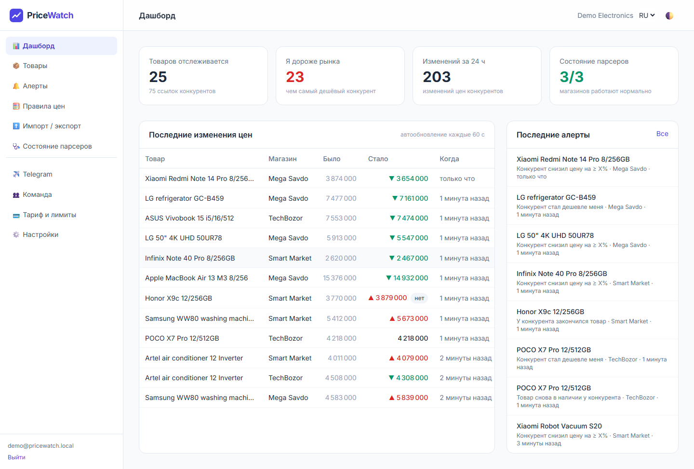
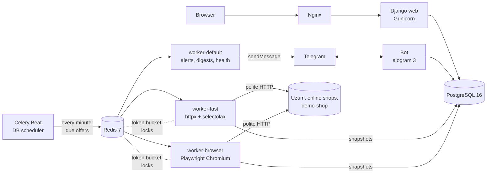
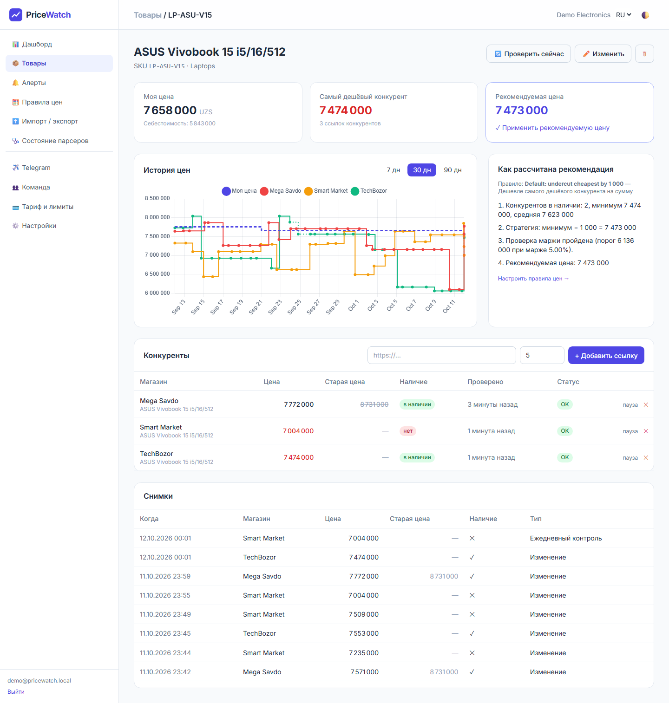
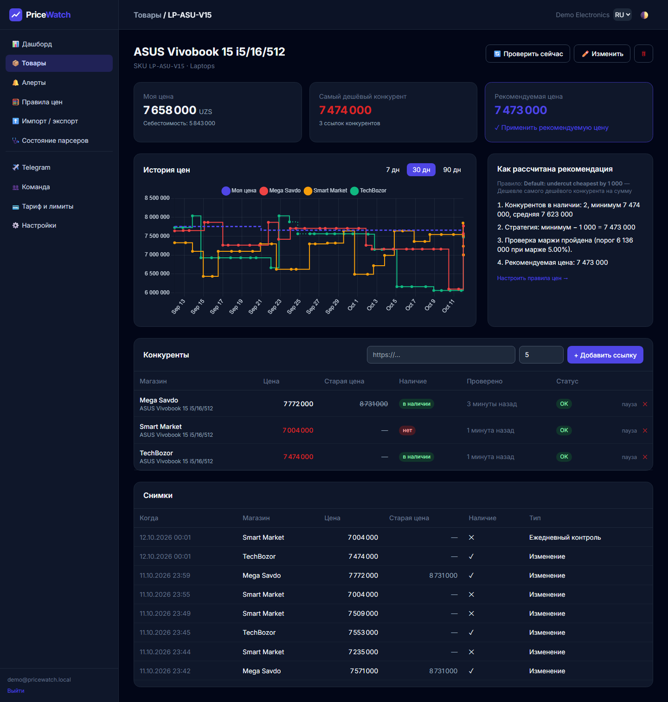
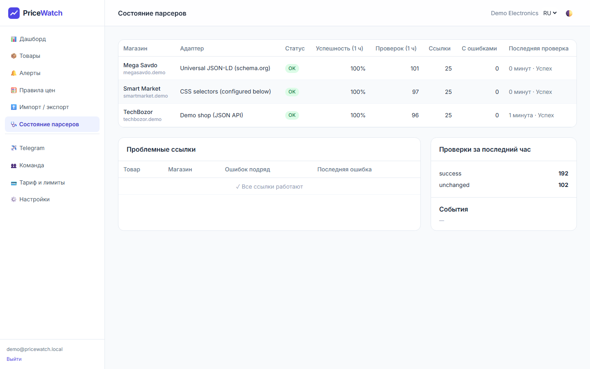
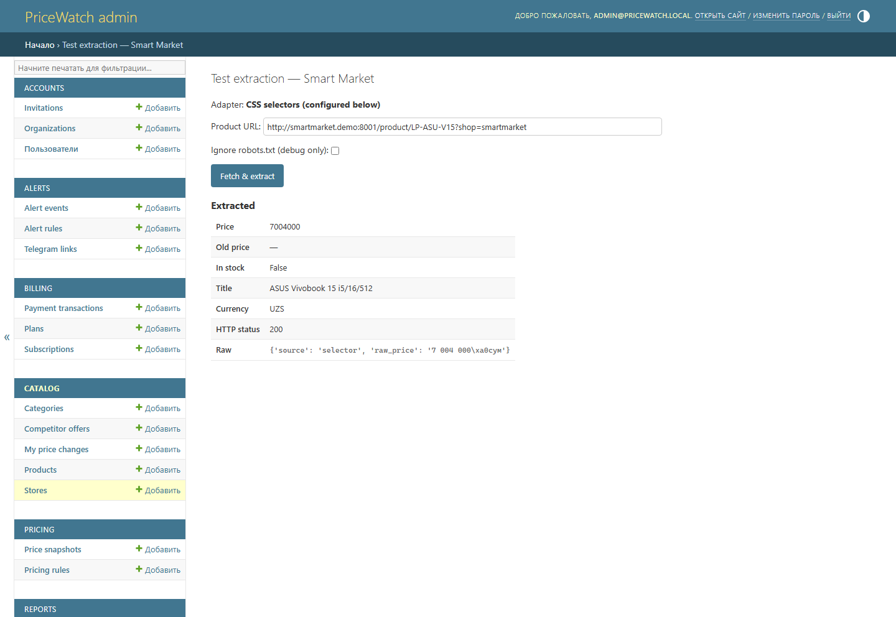
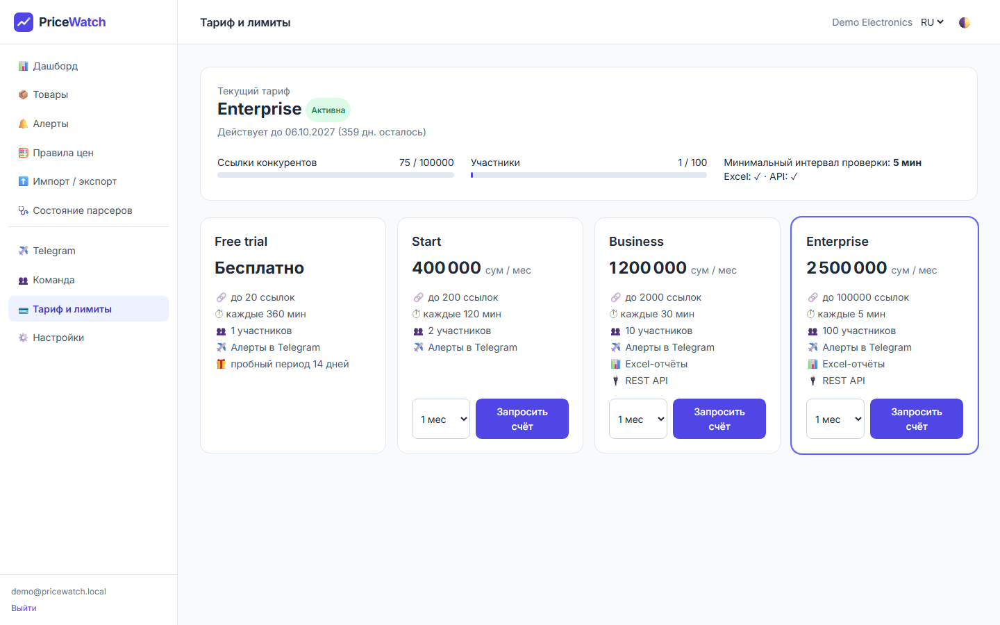
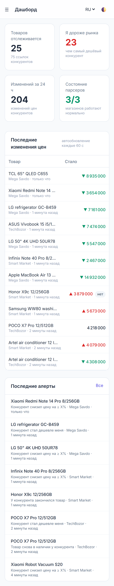

# PriceWatch — competitor price monitoring for Uzbekistan e-commerce

> Know the moment a competitor undercuts you on Uzum Market or any online shop — and what price to set in response.



## The problem

Sellers on **Uzum Market** and owners of online shops in Uzbekistan (electronics, appliances, cosmetics, kids' goods) compete mostly on price. Today their managers open dozens of competitor pages by hand every morning, copy prices into Excel and still miss the flash discount that took their sales away at 2 p.m.

## The solution

PriceWatch is a multi-tenant SaaS:

1. A business adds its products (SKU, my price, cost price) and links to the same products at competitors — by hand, from Excel or via the REST API.
2. Workers check every link on a schedule (from every 5 min to every 6 h depending on the plan), store compact price history and detect changes.
3. Telegram alerts arrive instantly: *competitor dropped the price by ≥ 5%*, *became cheaper than me*, *ran out of stock*, *is back in stock* — grouped so a product never spams more than once per 30 minutes.
4. The pricing engine recommends a price (undercut / match / market average) that **never breaks the minimum margin**, and the alert has a one-tap “Apply” button.
5. Every morning at 09:00 Tashkent time a digest summarizes the last 24 hours.

## Key features

| Area | What's inside |
|---|---|
| Scraping | Plugin adapters: **JSON-LD** (works on most shops out of the box), **CSS selectors configured in the admin** (new shop without code), **Uzum Market** (Playwright, tested on live pages), demo shop. Robust price parser (25+ formats: `1 299 000 сум`, `1.299.000`, `so'm`, NBSP…) |
| Politeness | robots.txt (24 h cache), per-domain Redis token bucket, UA rotation, random delays, exponential backoff + jitter, `Retry-After`, optional proxy rotation. Never logs in, never bypasses captchas |
| Data quality | Snapshot de-duplication (store only on change + daily control), **suspicious price guard** (×5 jump or 0 ⇒ re-check in 10 min, no alert until confirmed) |
| Reliability | Scraper health: success rate per store per hour, `SCRAPER_DEGRADED` events to the admin's Telegram, “Scraper health” page |
| Alerts | 5 rule types, scope (all / category / product), Telegram + e-mail, anti-spam grouping |
| Telegram bot | aiogram 3, ru/uz/en, `/products`, `/check SKU`, `/report`, `/lang`, inline “Apply price” / “Mute alert” |
| Web app | Django + HTMX + Tailwind + Chart.js, dark mode, mobile layout, CSV/Excel import with error report, formatted Excel export |
| SaaS | Organizations, roles (owner / manager / viewer), invitations, plans with limits (links, check frequency, members, API, Excel), payment-provider interface (Click / Payme stubs) |
| API | DRF + token auth + OpenAPI/Swagger (`/api/docs/`) |
| Ops | Docker Compose (10 services, all with healthchecks), Nginx, Caddy (HTTPS), Sentry, `/health/`, backups with restore check, GitHub Actions CI |
| Quality | 217 tests, **90% coverage**, ruff + mypy clean |

## Architecture



Scrape pipeline: `robots.txt → rate limit → adapter.fetch → validate (suspicious?) → dedupe → PriceSnapshot → alert rules → grouped delivery`.

## Stack

Python 3.12 · Django 5.2 · DRF · drf-spectacular · PostgreSQL 16 · Redis 7 · Celery 5 + django-celery-beat · httpx · selectolax · Playwright · aiogram 3 · HTMX · Tailwind · Chart.js · openpyxl · pytest · factory_boy · respx · ruff · mypy · Docker · Nginx · Caddy · Sentry

## Quick start (3 commands)

```bash
cp .env.example .env
docker compose up -d --build
docker compose exec web python manage.py seed_demo
```

Open <http://localhost> (or <http://localhost:8000>) → `demo@pricewatch.local` / `demo12345`.
Admin: <http://localhost/admin/> → `admin@pricewatch.local` / `demo12345`. API docs: <http://localhost/api/docs/>.

The bundled **demo-shop** (3 fake stores, 36 products) changes prices every 90–120 s, so within a few minutes you see new snapshots and alerts.

## Screenshots

| | |
|---|---|
|  |  |
|  |  |
|  |  |

## Documentation

| Document | Contents |
|---|---|
| [docs/RUN.md](docs/RUN.md) | Running locally (Windows / Linux / macOS), logs, adding a shop via the admin, troubleshooting |
| [docs/DATA.md](docs/DATA.md) | Every `.env` variable and how to obtain it (BotFather, Sentry, proxies…), what data a client must provide |
| [docs/RENDER.md](docs/RENDER.md) | Free one-click demo deployment on Render.com |
| [docs/PRODUCTION.md](docs/PRODUCTION.md) | Server choice, step-by-step deploy, HTTPS, backups, monitoring, scaling, security checklist |
| [docs/BUSINESS.md](docs/BUSINESS.md) | Pricing, unit economics, sales playbook for Uzbekistan |
| [docs/DEMO_SCRIPT.md](docs/DEMO_SCRIPT.md) | 90-second demo video script |
| [docs/DECISIONS.md](docs/DECISIONS.md) | Architecture decisions and trade-offs |
| [SETUP_GUIDE.txt](SETUP_GUIDE.txt) | Everything needed to run the project, in one plain-text file |

## Development

```bash
python -m venv .venv && .venv/Scripts/activate   # Windows (Linux/macOS: source .venv/bin/activate)
pip install -r requirements-dev.txt
cp .env.example .env.local   # then set DATABASE_URL=sqlite:///db.sqlite3 and empty REDIS_URL — see docs/RUN.md
ENV_FILE=.env.local pytest --cov
ruff check . && ruff format --check . && mypy apps bot
```

## Ethics

PriceWatch collects only **publicly visible** prices, respects `robots.txt`, rate-limits every domain, never authenticates on target sites and never bypasses CAPTCHAs.

## License

MIT
